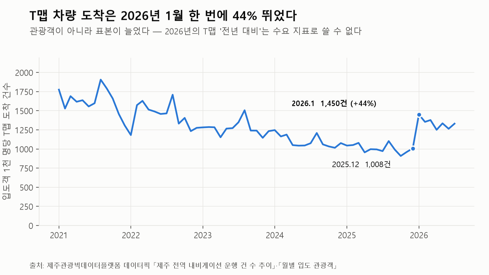
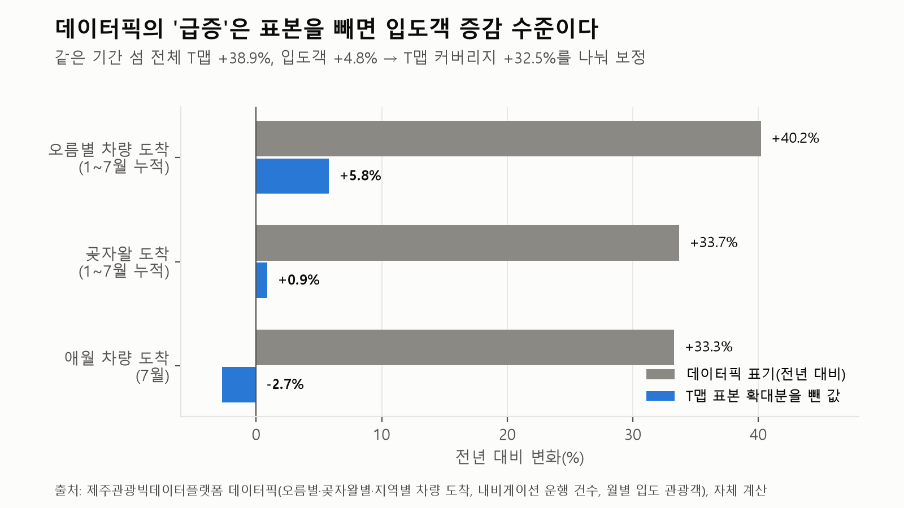
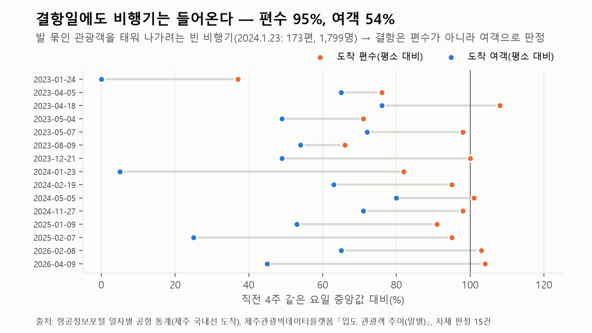
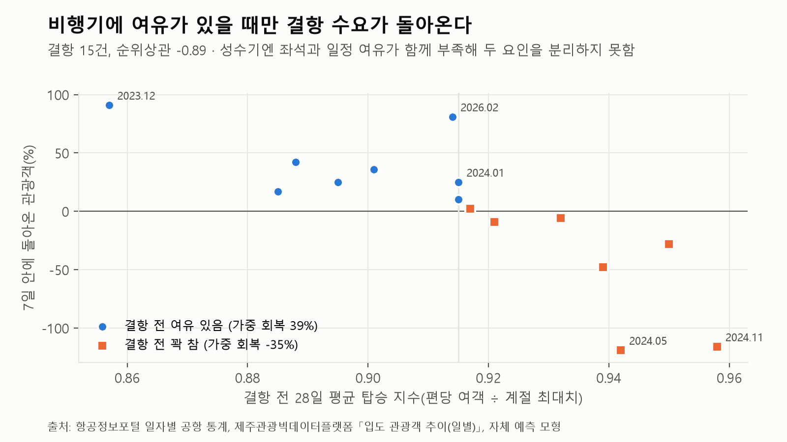
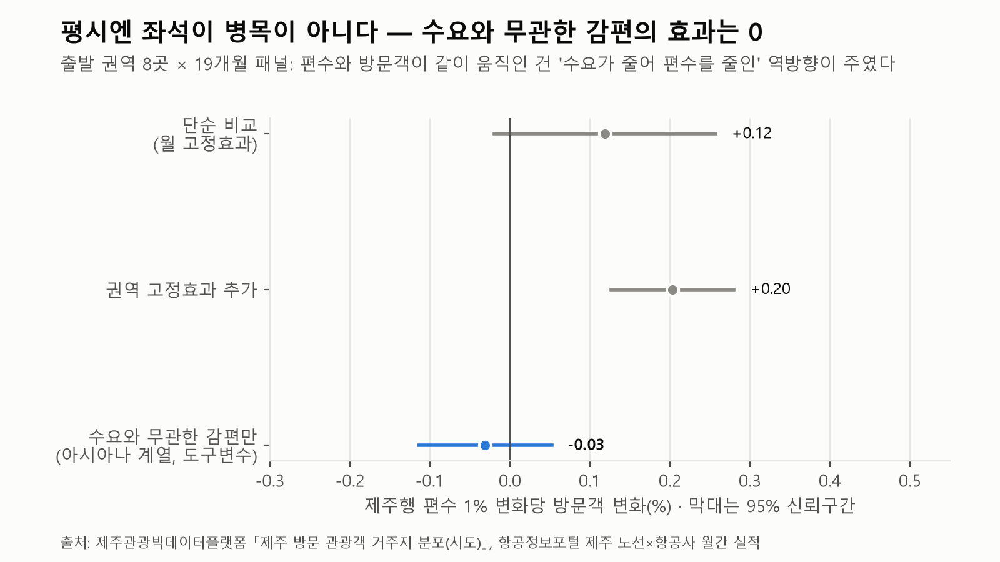
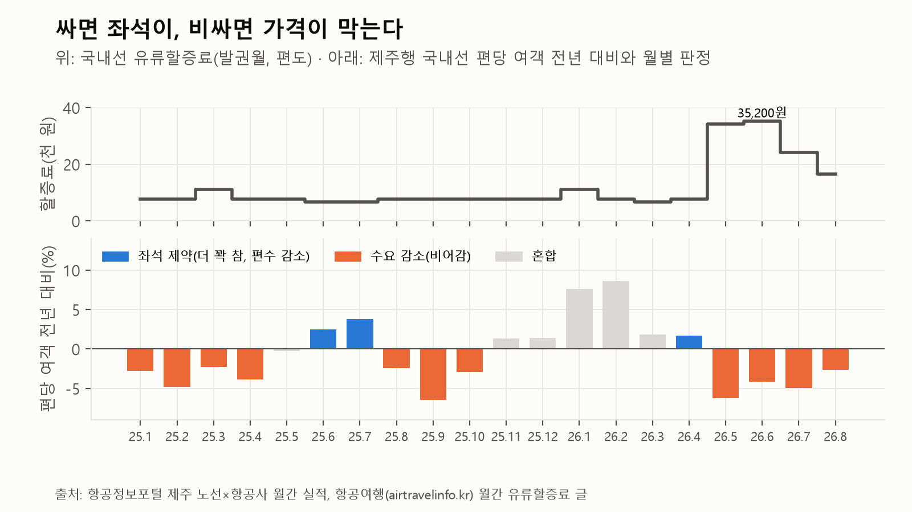
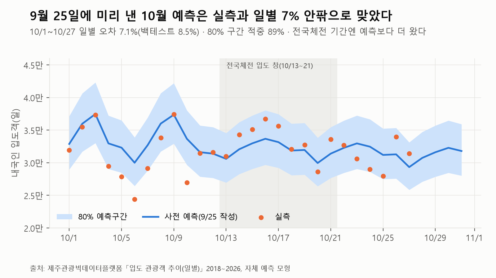

# 좌석이냐 가격이냐
## 제주관광빅데이터로 가른 2026년 내국인 관광 감소의 원인과 처방 — 자연실험 3개와 사전 예측 검증

2026 제주 관광 데이터 활용사례 공모전 응모작 결과보고서 (2026-10-28, 10/27까지 채점)

---

## 요약

2026년 제주 내국인 관광객은 5월부터 다시 줄었다(5월 -7.2%, 6월 -11.5%, 7월 -5.2%). 원인으로 좌석 부족, 고물가, 해외여행이 함께 거론되지만 처방은 원인에 따라 정반대다. 이 보고서는 제주관광빅데이터플랫폼 데이터와 항공 통계로 세 가지 자연실험을 설계해 원인을 갈랐다.

- **평시에는 좌석이 병목이 아니다.** 대한항공·아시아나 통합 과정에서 줄어든 아시아나 계열 편수로 좌석 효과를 추정하면 0이다(계수 -0.03, 표준오차 0.04).
- **2026년 5~8월 감소는 가격 쪽이다.** 유류할증료가 7,700원에서 34,100원으로 뛴 5월부터 제주행 편당 여객이 줄었다(-2.6~-6.3%). 할증료가 전년보다 1만 원 높으면 여객은 1.5% 줄었다.
- **좌석이 막는 건 쌀 때와 결항 때다.** 좌석 제약이 나타난 달(2025년 6·7월, 2026년 4월)은 모두 할증료가 낮았다. 결항으로 못 들어온 관광객은 7일 안에 11%만 돌아왔고 비행기가 꽉 차던 시기에는 회복이 없었다. 2023~2026년 결항 15건의 순손실은 관광객 약 22.7만 명, 소비 425억~1,448억 원이다.
- **플랫폼 지표에는 착시가 있다.** T맵 차량 도착은 2026년 1월에 표본이 44% 커져, 데이터픽의 '오름 도착 +40.2%'는 보정하면 +5.8%다.

정책 시사점은 **"평시엔 가격 대응, 성수기 결항엔 임시편·대형기 투입"**이다. 10월 일별 입도객은 9월 25일에 미리 예측해 두고 실측으로 채점했다. 10/1~27 일별 오차는 7.1%로 백테스트(8.5%)보다 작았고, 연휴에 좌석 천장은 없었으며, 전국체전 기간에는 관광객이 밀려나지 않고 예측보다 1.2만~2.2만 명 더 들어왔다.

---

## 1. 문제와 연구 질문

제주 내국인 입도객은 2022년 1월 1일~9월 24일 1,012만 명에서 2025년 같은 기간 825만 명으로 줄었다. 2026년 1~3월은 전년의 항공 참사·계엄 기저효과로 반등했지만(1월 +14.5%, 2월 +21.7%) 5월부터 다시 감소했다(플랫폼 「입도 관광객 추이(일별)」 월 합계 기준). 제주도는 8월 '항공좌석 공급안정화 TF'를 꾸렸다.

원인 진단은 엇갈린다. 좌석이 모자라면 증편과 슬롯 확보가 답이다. 반면 값이 문제면 좌석을 늘려도 빈자리만 는다. 이 둘을 가르는 것이 이 보고서의 목적이다.

- **질문 1.** 언제 좌석이, 언제 가격이 관광객을 막는가?
- **질문 2.** 좌석을 잃으면(결항) 관광객과 소비가 얼마나 사라지고 무엇이 회복을 가르는가?
- **질문 3.** 이 판단을 미리 예측으로 적어 두고 실측으로 확인할 수 있는가?

## 2. 데이터

| 구분 | 데이터 | 기간·단위 | 쓰임 |
|---|---|---|---|
| 플랫폼 | 데이터픽 「입도 관광객 추이(일별)」 | 2018.1.1~2026.9.24, 일 | 수요 기준선, 결항 판정, 사전 예측 |
| 플랫폼 | 데이터픽 「제주 방문 관광객 거주지 분포(시도)」 | 2025.1~2026.7, 월 | 출발 권역별 방문 변화 |
| 플랫폼 | 데이터픽 「월별 입도 관광객」, 「제주 전역 내비게이션 운행 건 수」, 「카드 소비금액·건수 추이」, 「제주 성별 방문객」 | 2020~2026, 월 | 지표 간 대조, 표본 단절 점검 |
| 플랫폼 | 데이터픽 「제주여행 1인당 여행경비」(방문관광객 실태조사) | 2018~2025, 연 | 손실 관광객의 소비 환산 |
| 플랫폼 | 공지 「신용카드 소비데이터 공급사 변경 안내」(2026.9.10) | — | 카드 자료 해석 기준 |
| 외부 | 항공정보포털 일자별 공항 통계 | 2023.1.1~2026.9.24, 일 | 결항 확인, 편당 여객 |
| 외부 | 항공정보포털 제주 노선×항공사 실적 | 2023.1~2026.8, 월 | 권역별 공급, 편당 여객 |
| 외부 | 국내선 유류할증료(항공사 공지) | 2024.5~2026.10, 월 | 가격 변수 |

플랫폼 자료는 데이터픽 화면과 같은 원천의 차트 데이터로 받았다(공공누리 제1유형). 항공 통계는 국토교통부·한국항공협회 항공정보포털의 공개 통계다. 유류할증료는 항공사 공지를 정리한 월간 글에서 원문 문장을 확인해 옮겼다. 글이 없는 달은 다음 달 글의 "전월 대비" 문장으로 거꾸로 계산했다(한 단계 1,100원).

## 3. 데이터 점검: 지표 착시부터 걷어냈다

플랫폼 지표를 입도객과 맞대어 보면 표본이 바뀐 곳이 네 군데 있다.

1. **T맵 차량 도착의 2026년 1월 계단.** 입도객 1천 명당 T맵 도착 건수가 2025년 12월 1,008건에서 2026년 1월 1,450건으로 44% 뛰었다(그림 1). 2023년 1월 1,282건에서 2025년 월평균 1,000건 안팎으로 줄던 지표다. 1~7월 누적으로 보면 섬 전체 T맵은 +38.9%, 입도객은 +4.8%라서 커버리지가 +32.5% 커진 셈이다. 데이터픽 첫 화면의 '내비게이션 운행 건수 +38.9%'는 이 표본 확대분 그 자체다.
2. **카드 소비의 2020→2021 단절.** 내국인 관광객 1인당 카드 소비가 2020년 12월 약 5.6만 원에서 2021년 1월 약 23.2만 원으로 4.1배 차이 난다.
3. **카드 공급사 교체.** 2026년 9월 신한카드에서 BC카드로 바뀌며 2020년 이후 전 기간이 교체됐다. 2025년 12월 이후 일부는 POI 좌표 재매핑으로 다시 수정됐다(9.18 공지).
4. **행정구역 통합.** 거주지 자료에서 2026년 7월부터 광주광역시와 전라남도가 '전남광주통합특별시'로 합쳐졌다.

섬 전체 대비로 정규화하면 데이터픽의 '급증' 지표는 입도객 증감 수준으로 돌아온다(그림 2). 오름 도착 +40.2%는 +5.8%, 곶자왈 +33.7%는 +0.9%, 애월 차량 도착(7월) +33.3%는 -2.7%다. 이 점검을 바탕으로 수요 판단에는 입도객, 이동통신 방문객, 항공 여객만 썼다.

## 4. 수요 기준선: 일별 입도객 예측 모형

결항과 행사 효과를 재려면 "그날 평소라면 몇 명이 왔을까"가 필요하다. 일별 내국인 입도객(2023.1~2026.9)의 로그값을 다음 요소로 설명하는 회귀 모형을 만들었다.

- 요일
- 연휴 안의 위치(전날, 첫날, 둘째 날, 중간, 마지막 날, 다음 평일)
- 설·추석 전후 2주
- 연중 계절 곡선과 여름 성수기 요일 모양
- 연월 수준

폭설·태풍처럼 모형에서 크게 벗어난 날(로그 잔차 0.25, 약 25% 초과)은 계수를 왜곡하므로 한 번 적합한 뒤 그런 날을 빼고 다시 적합했다. 예측할 달의 수준은 두 추정치의 평균으로 잡았다. 하나는 직전 달 수준에 과거 연도들의 계절 차이를 더한 값, 다른 하나는 작년 같은 달 수준에 최근 두 달의 전년 대비 변화를 더한 값이다.

| 백테스트(2024.3~2026.9, 31개월 × 매달 3일 전 시점) | 예측 모형 | 비교(364일 전 × 최근 비율) |
|---|---|---|
| 일별 평균 오차(MAPE) | 8.5% | 9.6% |
| 결항 의심일 제외 | 7.7% | 8.8% |
| 월 합계 절대오차 | 5.1% | 5.5% |
| 비교 방식보다 나았던 달 | 18/31 | — |

## 5. 자연실험 1 — 결항

### 5.1 판정
결항은 날씨가 정하므로 좌석이 갑자기 사라지는 외생 충격이다. 다음 두 조건을 모두 만족한 날을 결항으로 판정했다(2023.1~2026.9, 15건). 5일 이상 연휴가 끝난 뒤 3일은 수요 급감과 헷갈리므로 뺐다.
- 플랫폼 입도객이 모형 예측의 75% 미만
- 항공정보포털 제주 도착 국내선 여객이 직전 4주 같은 요일 중앙값의 80% 미만

### 5.2 빈 비행기
결항일에도 도착 편수는 평소의 95%(중앙값)였다. 그런데 도착 여객은 54%였다(그림 3). 2024년 1월 23일 폭설 날에는 173편이 들어왔지만 여객은 1,799명, 편당 10명이었다. 발 묶인 관광객을 태워 나가려고 빈 비행기가 들어오기 때문이다. 결항은 편수가 아니라 여객으로 판정해야 한다. 공항 여객의 감소율과 입도객 감소율은 거의 같아서 입도객 급감이 통계 오류가 아니라는 것도 확인됐다.

### 5.3 회복과 여유 좌석
못 들어온 관광객 가운데 이후 7일 안에 다시 온 비율은 가중 평균 11%(중앙값 10%)다. 결항 전 이틀도 평균 4,371명이 덜 왔다(예보 영향으로 보인다).

회복을 가른 것은 결항 전 비행기의 여유였다(그림 4). 결항 전 28일 평균 탑승 지수(편당 여객 ÷ 계절 최대치)와 회복률의 순위상관은 -0.89다(n=15). 회복률을 ±100%로 자른 회귀에서도 탑승 지수 0.01당 -16.8%p(표준오차 3.2)로 같은 결론이다. 탑승 지수가 중앙값(0.915) 이하였던 8건은 39%가 돌아왔고 그보다 높았던 7건은 기준보다 오히려 35% 적었다.

### 5.4 손실 환산
회복분을 뺀 순손실은 관광객 약 22.7만 명이다. 1인 소비를 플랫폼 카드 포착액(2025년 내국인 관광객 1인 18.7만 원)으로 잡으면 약 425억 원, 실태조사 1인 여행경비(63.7만 원)로 잡으면 약 1,448억 원이다.

### 5.5 한계
성수기에는 좌석 여유와 여행 일정의 유연성이 함께 부족하다. 그래서 회복 차이가 좌석 때문인지 일정 때문인지 떼어 내지 못했다. 판정의 첫 조건이 모형 예측에 기대므로 모형 오차가 일부 섞일 수 있다.

## 6. 자연실험 2 — 노선 재편

출발 권역 8곳(수도권, 부산·경남, 울산, 대구·경북, 광주·전남, 충청, 전북, 강원) × 19개월(2025.1~2026.7) 패널을 만들었다. 각 권역의 플랫폼 이동통신 방문객 전년 동월 대비 변화를 그 권역 공항의 제주행 편수 변화에 회귀했다.

| 추정 | 편수 1% 변화당 방문객 변화 | 표준오차 |
|---|---|---|
| 월 고정효과 | +0.12% | 0.07 (p=0.09) |
| 월 + 권역 고정효과 | +0.20% | 0.04 |
| 아시아나 계열 감편을 도구변수로 | **-0.03%** | 0.04 |

단순 비교에서는 편수와 방문객이 같이 움직인다. 2026년 7월만 봐도 양양 신규 취항으로 강원 방문객은 +10.2%, 편수가 10% 넘게 준 울산(-21.7%)과 대구·경북(-9.4%)은 줄었다. 그러나 통합 일정에 따라 줄어든 아시아나 계열 편수만 떼어 보면 효과는 0이다(그림 5). 평시의 상관은 "수요가 줄어 항공사가 편수를 줄였다"는 역방향이 주였고 줄어든 편은 다른 항공편이 흡수했다.

**한계:** 아시아나 계열 감편이 지역 수요와 무관하다는 것은 가정이다. 또한 편수는 좌석과 같지 않다(기재 소형화로 좌석은 편수보다 더 줄었다).

## 7. 자연실험 3 — 가격

좌석이 모자라면 비행기가 더 차고 수요가 빠지면 빈다. 그래서 제주행 국내선의 편당 여객 전년 대비로 달마다 원인을 판정했다. 편당 여객이 1% 넘게 늘고 편수가 줄면 '좌석 제약', 1% 넘게 줄면 '수요 감소'로 봤다.

| 2026년 | 편수 | 여객 | 편당 여객 | 할증료(편도) | 판정 |
|---|---|---|---|---|---|
| 4월 | -4.5% | -2.9% | +1.7% | 7,700원 | 좌석 제약 |
| 5월 | -2.3% | -8.5% | -6.3% | 34,100원 | 수요 감소 |
| 6월 | -7.7% | -11.6% | -4.2% | 35,200원 | 수요 감소 |
| 7월 | -2.0% | -6.9% | -5.0% | 24,200원 | 수요 감소 |
| 8월 | 0.0% | -2.6% | -2.6% | 16,500원 | 수요 감소 |

2025년 5월~2026년 8월(16개월) 회귀에서, 할증료가 전년보다 1만 원 높으면 제주행 여객은 1.5%(편수 통제, p=0.11), 편당 여객은 1.6%(p=0.05) 줄었다. 2026년 5~6월은 할증료가 전년보다 2.6만~2.9만 원 높았으므로 가격만으로 여객이 약 4% 줄어든 셈이다. 좌석 제약이 나타난 달(2025년 6·7월 6,600원, 2026년 4월 7,700원)은 모두 할증료가 쌌다(그림 6). **싸면 좌석이, 비싸면 가격이 막는다.**

**한계:** 월 자료 16개월이라 크기는 참고치다. 할증료 밖의 운임(특가, 기본운임)은 관측하지 못했고 발권월과 탑승월의 시차도 반영하지 않았다.

## 8. 기각한 가설

틀릴 수 있는 가설을 먼저 데이터에 부딪쳤다.

- **"크루즈 관광객 소비는 카드 통계에 안 잡힌다."** 월별 외국인 카드 소비를 항공·여객선 외국인과 크루즈 승객으로 나눠 회귀했다. 수준 회귀에서는 크루즈 계수가 0 근처였지만 추세를 뺀 1차 차분에서는 크루즈 1인 약 17만 원(표준오차 7만), 항공 외국인 약 33만 원이었다. 수준 회귀의 0은 추세 교란이었다. **기각.**
- **"관광 소비가 도외로 새고 있다."** 실태조사 1인 여행경비 대비 제주 카드 포착액 비율은 2022년 31.5%, 2023~2025년 29.4~29.7%로 일정했다. **기각.**
- **"올해 성수기 피크가 더 눌렸다(좌석 천장)."** 처음 계산에서는 피크가 중앙값보다 더 줄었다. 하지만 2025년만 10월 황금연휴를 포함한 불공정 비교였다. 같은 기간(1/1~9/24)으로 맞추면 중앙값 -0.6%, 상위 10일 -0.6%로 차이가 없다. **기각.** 연중 상시 천장은 없다.

## 9. 사전 예측 검증

10월 일별 입도객을 9월 25일(9/24까지의 데이터)에 미리 예측해 두었다(그림 7). 월 합계 예측은 약 100.8만 명이다(작년 10월 113.7만 명은 7일 황금연휴 포함). 채점 규칙도 미리 정했다.

- **M1 예측 우위:** 결항일을 뺀 일별 오차가 비교 방식보다 작은가
- **M2 구간 적중:** 80% 예측구간 적중률
- **H1 연휴 천장:** 예측이 가장 높은 4일(10/2·3·8·9)의 잔차가 평상일보다 0.05 이상 낮으면 천장으로 판정한다. 행사 없던 18개월 위약 검사의 평균은 +0.027, 오탐률은 11%다.
- **H2 전국체전(10/16~22, 참가 약 2만9천 명):** 입도 창(10/13~21)의 잔차가 평상일보다 +0.05 이상이면 '여유' 쪽(우도비 약 5.5), +0.02 이하이면 '구축·천장' 쪽(우도비 약 3.4)으로 판정한다.

| 채점 결과(10/1~10/27, 27일) | 값 |
|---|---|
| 일별 오차 (예측 모형 / 비교 방식) | 7.1% / 15.6% |
| 80% 구간 적중률 | 89% (24/27일) |
| 합계 오차 | +2.2% (예측 881,529명 / 실측 862,348명) |
| H1 (연휴 천장) | Δ1 +0.015 (표준오차 0.032) → 기준(-0.05) 미달, 천장 없음 |
| H2 (전국체전) | Δ2 +0.074 (표준오차 0.032) → 기준(+0.05) 충족, '여유' 쪽 |

- **예측 모형은 사전에 정한 기준을 지켰다.** 일별 오차 7.1%는 백테스트 31개월(8.5%)보다 작고, 80% 구간 적중률도 89%로 명목 수준을 넘었다. 결항으로 판정된 날은 없었다. 비교 방식(작년 같은 요일)의 15.6%는 작년 추석 연휴(10/3~9)와 날짜가 어긋난 탓이 커서 우위의 근거로 쓰지 않는다.
- **연휴에 좌석 천장은 없었다.** 예측이 가장 높던 4일(10/2·3·8·9)이 예측과 0~6% 안에서 맞았다. 10월 연휴는 평시와 같이 좌석이 관광객을 막지 않았다.
- **전국체전은 관광객을 밀어내지 않고 더해졌다.** 입도 창 9일(10/13~21)의 입도객은 예측보다 1.2만 명 많았고, 10월 평상일의 과대예측(-3.5%)을 보정하면 2.2만 명이다(참가 규모 약 2만9천 명). 10/14~17에는 공항 도착 여객도 하루 약 4만 명으로 평소(3.1만~3.6만 명)보다 많았다. 좌석 여유가 있는 평시에는 행사 수요가 그대로 얹힌다는 뜻이고, 5~8월 감소가 좌석이 아니라 가격 쪽이라는 판정과 맞는다.
- 한계: 채점은 마감 전까지 들어온 10/27까지다. 위약 검사 기준 H2의 오탐 가능성은 남아 있어 '여유 쪽'이라는 우도비 판정으로만 보고한다.

## 10. 정책 시사점

1. **월별 판정 규칙.** 편당 여객이 늘고 편수가 줄면 좌석, 편당 여객이 줄면 수요·가격으로 본다. 플랫폼 일별 입도객과 항공 통계만으로 매달 판정할 수 있다.
2. **항공좌석 TF.** 평시 좌석 확대의 관광객 효과는 제한적이다. 성수기 결항 때 임시편·대형기를 투입하는 가치가 가장 크다. 결항 1건의 순손실은 평균 약 1.5만 명이다.
3. **관광 마케팅·여행지원금.** 할증료 급등기(가격 제약기)에는 운임과 연계한 할인·지원이 맞다. 좌석 제약기에는 판촉보다 좌석 확보가 먼저다.
4. **플랫폼 개선 제안.**
   - T맵 2026년 1월 표본 변경 주석과 입도객 대비 보정 지표 제공
   - 카드 공급사 교체 전후 연결 계수 공개
   - '전년 대비' 옆에 섬 전체 대비 상대값 병기
   - 항공 공급석·결항 편수 추가

## 11. 한계와 향후 과제

- 좌석 수를 직접 관측하지 못해 편수와 편당 여객으로 대신했다. 노선별 공급석 자료를 쓰면 좌석 효과를 더 정확히 잴 수 있다.
- 결항 회복에서 좌석 여유와 일정 유연성을 분리하려면 성수기 안에서 여유가 다른 사건(예: 대형기 투입 여부)을 더 모아야 한다.
- 결항 판정은 9/24까지의 데이터로 맞춘 예측 모형 기준이다. 10/27까지의 데이터로 모형을 다시 맞추면 경계선에 있던 1건(2024-05-05)이 빠져 14건이 되고, 7일 회복률은 16%, 순손실은 약 21.8만 명(소비 408억~1,388억 원), 탑승지수 기울기는 -16.0%p(표준오차 3.2)가 된다. 회복이 작고 비행기가 찰수록 회복이 적다는 결론은 같다.
- 가격 효과는 할증료만 봤다. 실제 운임 자료로 넓히고 경쟁 관광지(강릉·부산·여수)와 해외 출국 수요를 함께 보는 확장이 필요하다.
- 이후 관광·교통 분야 학술지에 투고하고 판정표를 매달 공개 코드로 갱신할 계획이다.

## 12. 재현 자료

분석 코드와 정리된 데이터를 공개한다: https://github.com/Choihello/jeju-seat-or-price

| 경로 | 내용 |
|---|---|
| `scripts/model_d.py`, `calendar_kr.py`, `backtest.py`, `placebo.py` | 예측 모형, 달력 특징, 백테스트, 위약 검사 |
| `scripts/disruption_airportal.py` | 결항 판정·회복·손실 환산 |
| `scripts/origin_supply.py` | 출발 권역 × 노선 패널, 도구변수 추정 |
| `scripts/price_vs_seats.py` | 편당 여객 판정, 할증료 회귀 |
| `scripts/forecast.py`, `seal.py`, `score.py` | 10월 사전 예측 문서와 채점 |
| `scripts/make_figures.py` | 그림 1~7 |
| `data/platform/` | 제주관광빅데이터플랫폼 데이터픽 일별 입도객·시도별 방문객·T맵 대비 입도객(월) |
| `data/external/` | 항공정보포털 정리 자료, 유류할증료 월별(출처 문장 포함) |

---

## 부록 A. 결항 15건

| 시작 | 도착 여객비 | 도착 편수비 | 입도객 손실 | 7일 회복 | 회복률 | 결항 전 탑승지수 |
|---|---|---|---|---|---|---|
| 2023-01-24 | 0.00 | 0.37 | 31,416 | +11,415 | 36% | 0.901 |
| 2023-04-05 | 0.65 | 0.76 | 15,233 | +3,737 | 25% | 0.895 |
| 2023-04-18 | 0.76 | 1.08 | 10,586 | -592 | -6% | 0.932 |
| 2023-05-04 | 0.49 | 0.71 | 41,099 | -11,322 | -28% | 0.950 |
| 2023-05-07 | 0.72 | 0.98 | 11,063 | -5,268 | -48% | 0.939 |
| 2023-08-09 | 0.54 | 0.66 | 35,310 | +3,638 | 10% | 0.915 |
| 2023-12-21 | 0.49 | 1.00 | 31,555 | +28,598 | 91% | 0.857 |
| 2024-01-23 | 0.05 | 0.82 | 29,028 | +7,290 | 25% | 0.915 |
| 2024-02-19 | 0.63 | 0.95 | 13,281 | -1,218 | -9% | 0.921 |
| 2024-05-05 | 0.80 | 1.01 | 9,215 | -10,998 | -119% | 0.942 |
| 2024-11-27 | 0.71 | 0.98 | 8,873 | -10,302 | -116% | 0.958 |
| 2025-01-09 | 0.53 | 0.91 | 12,841 | +5,431 | 42% | 0.888 |
| 2025-02-07 | 0.25 | 0.95 | 22,196 | +3,741 | 17% | 0.885 |
| 2026-02-08 | 0.65 | 1.03 | 12,366 | +9,986 | 81% | 0.914 |
| 2026-04-09 | 0.45 | 1.04 | 17,319 | +294 | 2% | 0.917 |

## 부록 B. 월별 좌석/가격 판정 (제주행 국내선, 전년 대비)

| 월 | 편수 | 여객 | 편당 여객 | 할증료 | 판정 |
|---|---|---|---|---|---|
| 2025-05 | -2.3% | -2.6% | -0.3% | 7,700원 | 혼합 |
| 2025-06 | -3.5% | -1.1% | +2.5% | 6,600원 | 좌석 제약 |
| 2025-07 | -1.6% | +2.0% | +3.7% | 6,600원 | 좌석 제약 |
| 2025-08 | +0.4% | -2.1% | -2.4% | 7,700원 | 수요 감소 |
| 2025-09 | +2.4% | -4.2% | -6.4% | 7,700원 | 수요 감소 |
| 2025-10 | +3.8% | +0.7% | -2.9% | 7,700원 | 수요 감소 |
| 2025-11 | +9.1% | +10.6% | +1.3% | 7,700원 | 혼합 |
| 2025-12 | +9.1% | +10.6% | +1.4% | 7,700원 | 혼합 |
| 2026-01 | +8.8% | +17.0% | +7.6% | 11,000원 | 혼합(기저효과) |
| 2026-02 | +10.2% | +19.6% | +8.6% | 7,700원 | 혼합(기저효과) |
| 2026-03 | +8.0% | +9.9% | +1.8% | 6,600원 | 혼합(기저효과) |
| 2026-04 | -4.5% | -2.9% | +1.7% | 7,700원 | 좌석 제약 |
| 2026-05 | -2.3% | -8.5% | -6.3% | 34,100원 | 수요 감소 |
| 2026-06 | -7.7% | -11.6% | -4.2% | 35,200원 | 수요 감소 |
| 2026-07 | -2.0% | -6.9% | -5.0% | 24,200원 | 수요 감소 |
| 2026-08 | 0.0% | -2.6% | -2.6% | 16,500원 | 수요 감소 |
